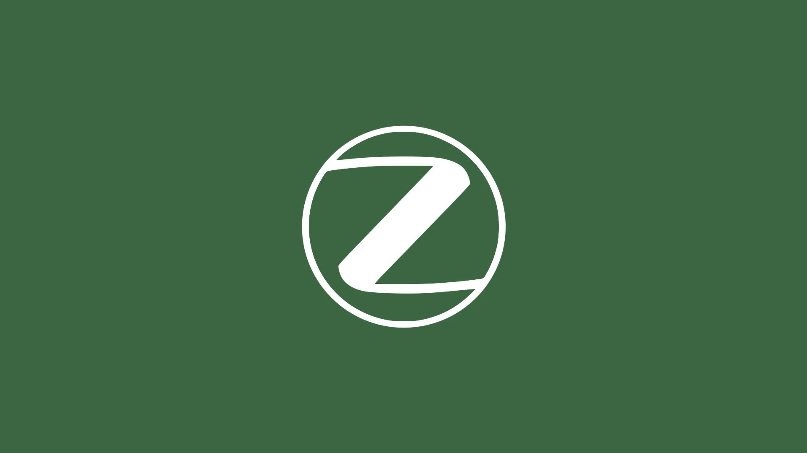
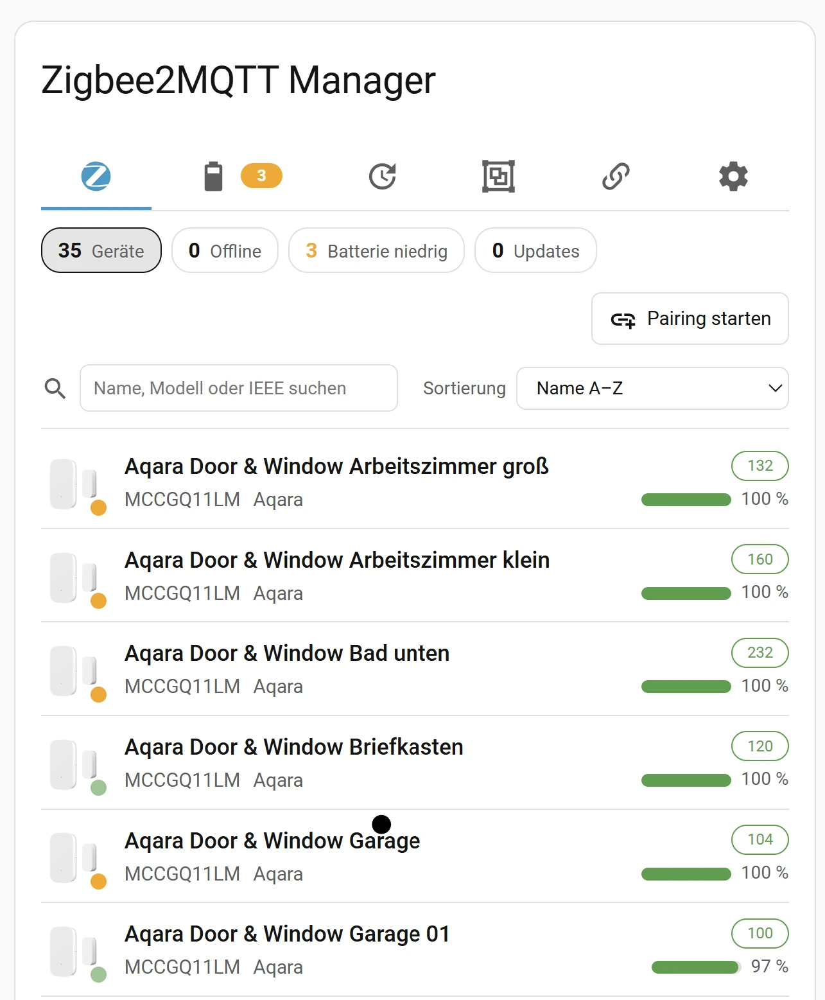
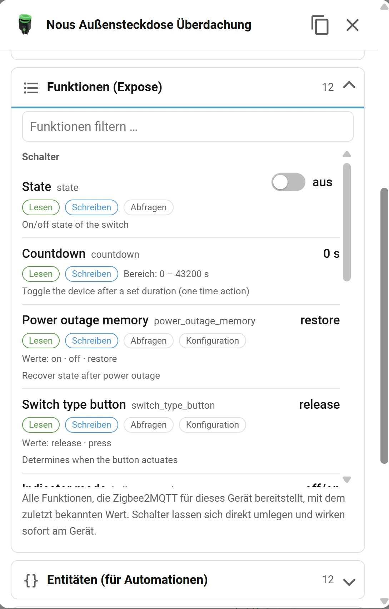
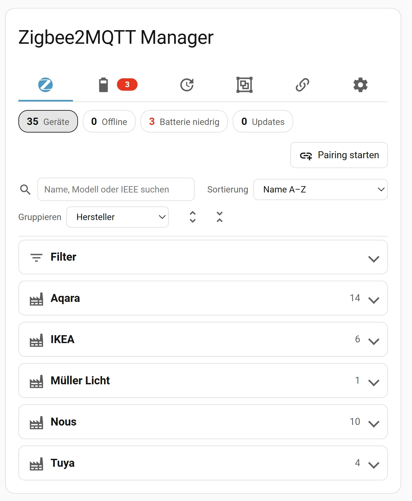
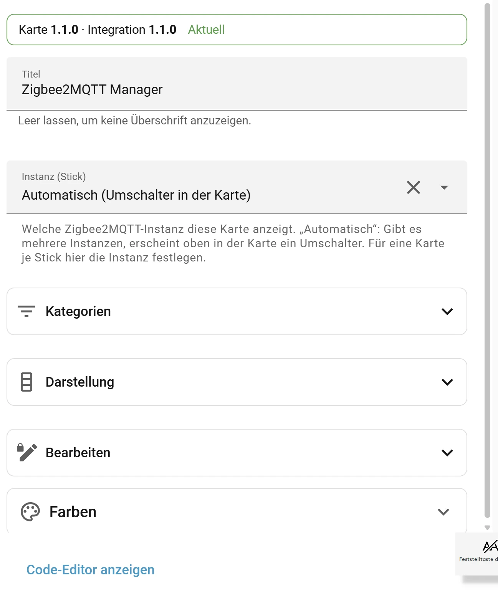

| [🇩🇪<br>**Deutsch**](README.md) | 🇬🇧<br>**English** | [🇳🇱<br>**Nederlands**](README.nl.md) | [🇫🇷<br>**Français**](README.fr.md) | [🇪🇸<br>**Español**](README.es.md) | [🇷🇸<br>**Српски**](README.sr.md) |
|:-:|:-:|:-:|:-:|:-:|:-:|



# Zigbee2MQTT Manager for Home Assistant

📖 **Detailed guide with background (German):** [Zigbee2MQTT Manager for Home Assistant on meinesmartewelt.de](https://meinesmartewelt.de/zigbee2mqtt-manager-home-assistant/)

Manage Zigbee2MQTT without leaving Home Assistant: devices, batteries, firmware updates, groups, bindings and the bridge in one dashboard card – as a HACS integration. Layout and design follow the card of [FRITZ!Box Anrufe](https://github.com/Meine-smarte-Welt/fritzbox_anrufe): icon categories, row lists, detail popup, accordion sections, graphical editor and freely adjustable colors.

## Contents

- [Features](#features)
- [New in 1.2.1](#new-in-121)
- [Screenshots](#screenshots)
- [Requirements](#requirements)
- [Installation](#installation)
- [The card](#the-card)
- [Colors](#colors)
- [Multiple instances (several sticks)](#multiple-instances-several-sticks)
- [Services](#services)
- [Events for automations](#events-for-automations)
- [Sensors](#sensors)
- [Version display and update notice](#version-display-and-update-notice)
- [Notification Center (optional)](#notification-center-optional)
- [Integration settings](#integration-settings)
- [Security](#security)
- [Known limitations](#known-limitations)
- [Troubleshooting](#troubleshooting)
- [Version history](#version-history)
- [File integrity](#file-integrity)

## Features

The card has six categories in an icon bar (icons only below roughly 480 px card width). Each category can be shown or hidden on its own.

| Category | What it does |
|---|---|
| **Devices** | List with reachability, model, signal, battery, "last seen"; statistic chips as filters (offline / low battery / updates); search; sorting; **grouping** by manufacturer or device class; **filters** (status, power, signal, …) |
| **Battery** | Battery devices, lowest first; colors by low and critical threshold |
| **Updates** | Installed vs. available firmware; "check all" and "install all one after another" as a background job with progress and cancel |
| **Groups** | Create, rename, delete; add and remove members |
| **Bindings** | Overview of all device bindings; unbind; bind again in the device popup |
| **Bridge** (cog) | **App version** (integration and card, colored notice when a new version exists), status, coordinator, pairing, bridge options, restart, event log, **Notification Center** |

**Device popup** (tap a row) with accordion sections: Information · **Features (expose)** · **Entities (for automations)** · Rename (with the list of affected HA entities) · Device options (form from the Z2M option schema) · Firmware · Bindings · Groups · Remove.

The **Features (expose)** section lists everything Zigbee2MQTT exposes for the device (switch, brightness, color, temperature, link quality …): name, property, **current value** with unit, access (read / write / get), value range or choices, description, and a configuration/diagnostic mark. Composite features (e.g. color x/y) and groups such as light or switch are resolved and grouped; from nine features on there is a filter field. While the section is open, values refresh when the device sends something (at most every 3 seconds). **Writable switches** (yes/no features, e.g. the state of a plug or light) can be toggled directly: the new value shows immediately and is confirmed by the device shortly after. If the value is still unknown, "On" and "Off" buttons appear instead. All other features are display only; control the device through its Home Assistant entities as before. With `read_only: true` the switches are hidden.

**Grouping and filters** (Devices, Battery and Updates): the **Group by** selector arranges the list as an accordion by **manufacturer** or **device class** (lights, plugs & switches, heating & climate, blinds & covers, locks, fans, buttons & remotes, sensors, other). Each group shows its count and, if any, its offline devices; the two icons beside the selector expand or collapse all groups. The collapsible **Filters** section narrows the list: status (online / offline), power source (battery only / mains only / low battery), signal (good / medium / weak), network role (router / end device), firmware (update available), last seen (more than 24 hours / 7 days ago), not in any Zigbee group, manufacturer and device class. Several filters apply together; active filters appear as small chips that a tap removes. The integration derives the device class from the device's features (Zigbee2MQTT provides no fixed class); devices without known features end up under "Other". Without Z2M availability enabled, online/offline is derived from "last seen", like the status dot. While grouping is active, `max_rows` does not apply.

**Area, HA device and comment (since 1.2.0):** the device list shows the Home Assistant **area** after the model (found through the matching MQTT device; option `show_area`). The popup also shows the name of the **Home Assistant device** and, if set in Zigbee2MQTT, the device **comment** (Z2M setting `description`). With `show_comment: true` the comment appears as a second line in the list. Search covers area, HA device and comment, and **Group by** gains **Area**. If an area or device name changes in Home Assistant, the card follows. The comment can be edited in the popup under **Comment** (text field, up to 500 characters; **Save** writes it through Zigbee2MQTT into the device setting `description`, an empty field removes it; not in read-only mode).

**Disabled devices (since 1.2.0, issue #7):** devices disabled in Zigbee2MQTT (`disabled: true`) no longer count as offline. They are left out of "Offline", the sensors, the problem sensor and the Notification Center messages, and get their own status "Disabled" (badge, filter **Status → Disabled**, counter `disabled`). The **Disabled** chip (only visible when such devices exist) filters the list, and the **Disabled devices** sensor counts them and carries the names as an attribute.

**Not heard for long (since 1.2.0):** if Zigbee2MQTT reports a device as online but it has sent nothing for more than N hours (default 24, adjustable under **Configure**, 0 = off), it gets the orange badge "silent", an orange status dot and the time since its last message in orange. There is also the **Silent** chip (only visible when such devices exist) and the filter **Status → Not heard for long**. The time since the last message ("5 seconds ago", "3 minutes ago") is shown in every row; sort by **Last seen (oldest first)** to put the quietest devices on top. This needs `advanced.last_seen: ISO_8601` in Zigbee2MQTT. The display is informational; it only triggers the problem sensor if you switch that on.

**Copying entities:** the popup section **Entities (for automations)** lists the device's Home Assistant entities with a copy icon per row. The copy icon in the popup header writes all entity names (one per line) to the clipboard, for example to paste into automations and scripts. If the browser denies clipboard access (it requires HTTPS), the text appears selected in a field so you can copy it with Ctrl+C.

Further points:

- **Cache:** Battery, signal, OTA state and "last seen" survive a Home Assistant restart (Z2M does not send device states retained).
- **Groups are no longer devices:** group topics do not show up as phantom devices.
- **Two-click confirmation** instead of a browser dialog for risky actions (remove, update, restart, unbind, delete).
- **Read only:** `read_only: true` hides all controls that change something (wall tablets).
- **Zoom:** `zoom` scales the whole card.
- **Languages:** German, English, Dutch, French and Spanish (following the Home Assistant language).
- **Diagnostics download** with anonymized names and IEEE addresses.

## New in 1.2.1

- **Network from the main view:** The card has its own **Network** category (icon in the bar, switch off with `show_network`); without a known address it explains how to enter it. The device list and **Bridge → Status** have a **Network** button that opens the Zigbee2MQTT network map. The address comes from (1) the card key `network_url`, (2) the integration option **Network map address**, (3) the Z2M setting `frontend.url` (with `/#/network` appended) or (4) the Zigbee2MQTT app in the sidebar (add-on with ingress). If no address is found, the button is hidden; `show_network_link: false` hides it too. *Unverified:* whether the path `/#/network` is right for every Z2M version and whether the add-on sidebar detection works on every setup – otherwise set `network_url` (e.g. `/a0d7b954_zigbee2mqtt`).
- **Links to the entity and the device:** In the popup, tapping an entity name (section **Entities**) opens that entity's dialog in Home Assistant; the copy icon stays. **Open device** (icon in the popup header and a button in the section) opens the device page in Home Assistant with all its entities. This needs Home Assistant to know the MQTT device.
- **Sidebar name:** Under **Configure** you can set the **sidebar name** (default "Zigbee2MQTT Manager", at most 40 characters). It is also the panel title, so the panel can be told apart from the Zigbee2MQTT app. The icon stays. The change applies immediately, no restart.
- **Missing devices:** The integration remembers every device Zigbee2MQTT has ever reported (name, vendor, model, picture, last values; survives restarts). If a device vanishes from the Z2M device list it stays visible **greyed out** with a **missing** badge. There is a **Missing** chip, the filter **Status → Missing in Zigbee2MQTT**, a **Missing devices** sensor (names as attribute), the event `zigbee2mqtt_manager_device_missing`, an entry in the event log and – if enabled – the Notification Center type `device_missing`. When the device returns, the marker disappears by itself. **Forget** (in the popup, or **Forget all missing** in the "Missing" filter) removes it from the memory for good; administrators only. Not counted as missing: devices you remove through the card or that Zigbee2MQTT reports as having left (10-minute grace period), and an empty device list (e.g. while the bridge starts). Missing devices are not counted under "Devices" and do not trigger the problem sensor.
- **innr sockets without picture (fixed):** For models with a space in the name (e.g. `SP 120`) the picture was missing because the card built the address differently from the Z2M frontend. It now replaces `:`, spaces and `/` with `-` like Z2M and also uses a picture reported by Zigbee2MQTT (`definition.icon`). *Unverified* on the affected sockets; if zigbee2mqtt.io has no picture for a model, the icon stays.
- **Base topic:** The option now shows the base topic in use in its description. Why the default topic `zigbee2mqtt` could apply after an update could not be traced in the code; the integration does not change the base topic itself. Check it under **Configure** if no devices appear after an update.
- **Languages:** New is **Српски (Cyrillic)** – README and card. The card has the key terms translated into Serbian; remaining texts show in English.

## Screenshots

The screenshots show version 1.1.0; the 1.2.x additions (network button, links, missing devices) are not visible yet.









## Requirements

- Home Assistant **2025.6** or newer
- Set-up **MQTT integration**
- **Zigbee2MQTT 2.x** (version 1.x is detected and reported in the card as unsupported)
- Recommended: set `availability: true` in Zigbee2MQTT, otherwise there is no online/offline status. For "last seen" also set `advanced.last_seen: ISO_8601`.

## Installation

1. HACS → ⋮ → **Custom repositories** → URL of this repository, category **Integration**
2. Install "Zigbee2MQTT Manager", restart Home Assistant
3. **Settings → Devices & services → Add integration → Zigbee2MQTT Manager**
4. Enter the base topic (default `zigbee2mqtt`) and choose the threshold for "low battery"

Manual: copy the folder `custom_components/zigbee2mqtt_manager` to `<config>/custom_components/`.

**Quick links (since 1.2.0):** [Add the repository in HACS](https://my.home-assistant.io/redirect/hacs_repository/?owner=Meine-smarte-Welt&repository=zigbee2mqtt_manager&category=integration) · [Set up the integration](https://my.home-assistant.io/redirect/config_flow_start/?domain=zigbee2mqtt_manager). After setup, Home Assistant shows a one-time notice, and the integration adds a **Zigbee2MQTT** entry to the sidebar (a Home Assistant panel, administrators only) that shows the card as a full page – no dashboard needed. It can be switched off under **Configure → Sidebar entry**. An integration cannot create a real Lovelace dashboard itself (Home Assistant offers no public interface for that); a ready-made template is in `examples/dashboard-zigbee.yaml`.

## The card

The integration serves the card and registers it as a Lovelace resource (persisted, with `?v=<version>` against stale browser caches). You do not have to add anything manually. If Lovelace runs in YAML mode, add `/zigbee2mqtt_manager_files/zigbee2mqtt-manager-card.js` as a resource of type `module`.

Add the card: **Edit dashboard → Add card → "Zigbee2MQTT Manager"**. The graphical editor groups all settings into collapsible sections (categories, appearance with columns, editing, network, colors). No YAML is needed, but possible:

```yaml
type: custom:zigbee2mqtt-manager-card
title: Zigbee2MQTT Manager   # empty ("") = no heading
# entry_id: abc123            # only with several Z2M instances
show_devices: true
show_battery: true
show_updates: true
show_groups: true
show_bindings: true
show_bridge: true
default_tab: devices
max_rows: 0                   # 0 = all, otherwise "show more"
zoom: 1
show_stats: true
show_images: true             # device images from zigbee2mqtt.io
show_search: true
show_filter_bar: true         # sort selection
default_sort: name_asc        # name_asc | name_desc | battery_asc | lqi_asc | last_seen_desc | last_seen_asc | ota
show_group_by: true           # "Group by" selector
default_group_by: none        # none | vendor | class
show_filters: true            # filters section
show_model: true
show_vendor: true
show_ieee: false
show_lqi: true
show_battery_value: true
show_last_seen: true
read_only: false
show_pairing: true
```

More examples: [`examples/`](examples/).

## Colors

In the editor under **Colors** (or via `color_*` keys). Each value may be hex (`#ff9800`), `rgb()`, `hsl()` or `var(--...)`. Empty means theme default. Invalid values are discarded. The swatch opens the color picker, the text field accepts any CSS value, "Reset all colors" clears everything.

| Key | Effect |
|---|---|
| `color_tab_active` | Active tab, primary buttons |
| `color_success` | Good: online, signal good, battery full, up to date |
| `color_warning` | Warning: battery low, signal medium, update running |
| `color_error` | Error: offline, battery critical, signal weak |
| `color_info` | Update available (firmware, new app version) |
| `color_row_icon` | All list icons (overrides the category colors) |
| `color_live_banner` | Banner background (pairing, firmware job) |
| `color_icon_devices`, `_battery`, `_updates`, `_groups`, `_bindings`, `_bridge` | Category icon – colors tab icon and row icons |

If `color_row_icon` is set, this single color wins.

## Multiple instances (several sticks)

If more than one Zigbee2MQTT instance runs (e.g. three coordinator sticks, each with its own Z2M), set up each as its own entry: **Settings → Devices & services → Add integration → Zigbee2MQTT Manager**, each with the matching **base topic** (`mqtt.base_topic` of that Z2M instance, e.g. `zigbee2mqtt`, `zigbee2mqtt2`, `zigbee2mqtt3`). Base topics must differ and must not be nested (not `zigbee2mqtt` and `zigbee2mqtt/stick2`), otherwise setup rejects them. Each instance gets its own sensors, events (with `base_topic` in the data) and its own cache.

The card offers two ways:

- **Switcher (default):** with more than one instance and none fixed, a stick selector appears at the top of the card. The choice is remembered in the browser.
- **One card per stick:** choose the instance under **Instance (stick)** in the card editor, or in YAML:

```yaml
type: custom:zigbee2mqtt-manager-card
base_topic: zigbee2mqtt2     # or: entry_id: abc123
```

`base_topic` is the simpler variant because the `entry_id` is not visible anywhere. If both are set, `entry_id` wins.

## Services

Both services are meant for automations. With several instances, `base_topic` (or `entry_id`) selects the instance. `check_updates` checks **all** instances if none is given; `permit_join` requires a choice with several instances so pairing never opens on all sticks at once by accident.

```yaml
action: zigbee2mqtt_manager.permit_join
data:
  base_topic: zigbee2mqtt2   # only with several instances
  enabled: true
  duration: 120      # seconds, 10–254, optional
```

```yaml
action: zigbee2mqtt_manager.check_updates
```

`check_updates` checks all OTA-capable devices in the background, one after another with a pause.

## Events for automations

Can be switched off in the integration options ("Fire Home Assistant events"). At startup only the initial state is recorded, so there is no flood of events.

| Event | Data |
|---|---|
| `zigbee2mqtt_manager_device_offline` / `_device_online` | `name`, `ieee`, `base_topic` |
| `zigbee2mqtt_manager_battery_low` | `name`, `ieee`, `battery` – when the threshold is crossed |
| `zigbee2mqtt_manager_update_available` | `name`, `ieee`, `installed`, `latest` |
| `zigbee2mqtt_manager_device_joined` / `_device_left` | `name`, `ieee` |
| `zigbee2mqtt_manager_device_missing` | `name`, `ieee` – a known device is missing from the Z2M device list (since 1.2.1) |

```yaml
triggers:
  - trigger: event
    event_type: zigbee2mqtt_manager_battery_low
actions:
  - action: notify.mobile_app_phone
    data:
      message: "{{ trigger.event.data.name }}: battery {{ trigger.event.data.battery }} %"
```

## Sensors

`Devices`, `Offline devices`, `Devices with low battery`, `Devices with critical battery`, `Available firmware updates`, `Disabled devices` and `Groups`. The sensors for offline, battery, updates and disabled devices carry the device list as an attribute. Since 1.2.1 there is also the sensor `Missing devices` (names as attribute).

### Collective problem sensor (binary sensor "Problem", since 1.2.0)

A binary sensor (device class `problem`) sums up the network in one state. It is **on** as soon as the bridge is offline, an active device is offline, a battery is low or critical, or (can be switched off) a firmware update is pending or (can be switched on) a device has not been heard from for long. Disabled devices do not count. It is meant for a small tile on your home page that turns red and opens the Zigbee dashboard on tap (`examples/kachel-leitseite.yaml`).

Attributes: `reasons` (`bridge_offline`, `offline`, `battery_low`, `battery_critical`, `update_available`, `stale`), `bridge_online`, `devices`, `offline`, `low_battery`, `critical_battery`, `updates_available`, `stale`, `disabled`, `stale_hours` and the name lists `offline_devices`, `low_battery_devices`, `critical_battery_devices`, `update_devices`, `stale_devices`, `disabled_devices`.

Under **Configure** you choose whether firmware updates (default: yes) and "not heard for long" (default: no) trigger the problem. The entity ID depends on the language (with an English UI e.g. `binary_sensor.zigbee2mqtt_manager_zigbee2mqtt_problem`); look it up under Settings → Devices & services. An automation that lists the devices is in `examples/sensor-stoerung-automation.yaml`. The counter sensors above also exclude disabled devices.

## Version display and update notice

The installed version is shown in three places: in the card under **Bridge (cog) → App version**, at the top of the graphical card editor, and in the integration's **Configure** dialog. At startup and every 12 hours the integration asks GitHub (`api.github.com`, latest release, falling back to the highest version tag) whether a newer version was published. If so, it is highlighted: orange frame and notice in the section, an orange "↑" on the cog icon, a warning box in the editor and a note in the Configure dialog. Updating itself works as usual through HACS. **Check now** triggers the query immediately. If GitHub is not reachable, "Check not possible" appears; the card keeps working.

If card and integration versions differ (stale browser cache), this is marked orange as well.

## Notification Center (optional)

**New in 1.2.0.** If the **Notification Center** integration is installed, Zigbee2MQTT Manager can send its notifications there. The Notification Center collects the notifications of all connected integrations and passes them on (push, voice, etc.). Without it nothing changes: the manager works as before, nothing is sent, and the switches have no effect.

The connection follows the shared interface (schema 1) over the Home Assistant event bus. The manager registers itself at startup and on request and reconciles its starting state. It is **on** by default and can be controlled in two places:

- **Card:** Bridge (gear) → **Notification Center** section with a main switch and one switch per notification type (administrators only, not in read-only mode). The change takes effect immediately, without reloading the integration.
- **Configure** dialog of the integration: "Send notifications to the Notification Center" and the choice of notification types.

| Notification type | Urgency | When |
|---|---|---|
| Bridge offline | critical | Zigbee2MQTT reports the bridge as offline; closed as soon as it is online again |
| Battery critical | critical | Battery level below the "critical battery" threshold |
| Device offline | warning | Zigbee2MQTT reports the device as offline |
| Battery low | warning | Battery level below the "low battery" threshold, but not below "critical" |
| Firmware update available | info | A firmware update is available for the device |
| New device | info | A device joined the network (once) |
| Device left the network | info | A device left the network (once) |

The existing thresholds from the integration options apply; there are no new thresholds. A device below the critical threshold appears only as "battery critical", not additionally as "low". A notification is created exactly once per change; when the condition ends (device back online, battery replaced), the notification is closed automatically. After startup the manager waits about 20 seconds after the device list before reporting the starting state; it is sent to the Notification Center as "initial" and does not cause a flood of push messages. The texts are available in German, English, Dutch, French and Spanish.

Privacy: the notifications contain device names and battery levels and stay inside Home Assistant. Diagnostics and logs contain only counters per notification type, no contents.

## Integration settings

Under **Configure** (showing the installed version): threshold "low battery", threshold "critical battery" (must be smaller or equal) events on/off, notifications to the Notification Center on/off and the choice of notification types. **Reconfigure** changes the base topic. Since 1.2.0 also: "Not heard for … hours" (0 = off), "Firmware updates trigger the problem" and "Not heard for long triggers the problem". Also: "Sidebar entry" (default: on).

## Security

All write actions (rename, options, toggling features, remove, firmware, groups, bindings, pairing, restart, version check, Notification Center settings) and loading device details are restricted to **administrators** over WebSocket. Input is validated by the backend (duplicate names, unknown options, allowed bridge values). When toggling a feature, the backend also checks that it exists, is writable and that the value is exactly its on or off value. The card escapes all text; color values pass through an allowlist.

## Known limitations

- **Z2M payloads untested:** `device/options`, the bindings structure in `bridge/devices` and the bridge options (`log_level`, `last_seen`). If your Z2M version differs, the affected function stays without effect or reports an error.
- Device options support simple types (number, switch, choice, text), no nested options.
- The entity preview when renaming finds devices via MQTT identifiers and can stay empty with unusual discovery configurations.
- "Install all" waits up to two hours per device for the update to finish.
- After a restart, battery, signal and OTA state first come from the cache and are refreshed with the next device message.
- **Offline display (since 1.0.5) and test status:** the card takes availability from Zigbee2MQTT. If a device sent live after an offline report, the card shows it as reachable. This was checked against simulated data, **not on real hardware**. Whether this removes the false offline displays reported in 1.0.4 (sensors, a plug) is open: feedback is explicitly welcome.
- The popup and the "Features (expose)" section were fixed in 1.0.5 (endless redraw loop), but also not tested on real hardware or in the iOS/Android companion app.
- **New in 1.1.0, test status:** grouping, filters, switches in the features and copying were checked against simulated data and in a headless browser, **not on real hardware** and not in the iOS/Android companion app. Whether Zigbee2MQTT accepts every switch as expected (e.g. on devices with several endpoints) is open.
- The device class is an approximation derived from the device's features; special cases may end up under "Other" or "Sensors".
- Switches act immediately without confirmation (including configuration switches such as child lock). The clipboard requires HTTPS.
- **New in 1.2.0, test status:** the Notification Center connection, the problem sensor, the "Disabled devices" sensor, area/HA device mapping, comment (display and editing), disabled devices with their chip, "not heard for long" and the sidebar entry were checked with simulated MQTT messages and registries (pytest with the Home Assistant test environment) and in a simulated browser (jsdom), **not on real hardware, not against a real Notification Center, not in Safari, Chrome, Firefox or the companion app, and not with 75 real devices**. The same applies to the fixes for flicker and scroll jump (issue #5); display values such as "last seen" and signal therefore update at most every 2 seconds. If the bridge restarts, devices may briefly be reported as offline and then closed again, depending on Zigbee2MQTT's availability settings. The HA device mapping finds the IEEE address in the MQTT identifiers; with unusual discovery, area and HA device stay empty. The comment comes from the Z2M device configuration (`description`) and is set via `bridge/request/device/options` when you save; whether your Z2M version includes it in `bridge/info` and accepts saving as expected is unverified. "Not heard for long" is informational and not its own notification type in the Notification Center. The sidebar entry is a Home Assistant panel, not a Lovelace dashboard (issue #6); it was only checked against the panel registration of the test environment, not in a real sidebar.
- **New in 1.2.1, test status:** network button, entity and device links, greyed-out missing devices and the sidebar-name dialog were checked against simulated data, **not on real hardware or a real Home Assistant installation**. The Serbian card is only partly translated.

## Troubleshooting

- **Card not found:** clear the browser cache; check under Settings → Dashboards → Resources that `/zigbee2mqtt_manager_files/…` exists (add manually in YAML mode).
- **Device shown offline but reachable:** Zigbee2MQTT itself reports the status (`<base_topic>/<device>/availability`). Check the value there, e.g. with MQTT Explorer (Settings → Devices & services → MQTT → Configure). In case of problems, please send the diagnostics download and name your Z2M `availability` setting (e.g. `timeout`) and the device model. For battery devices Z2M only sets "offline" after hours without a message.
- **No online/offline status:** enable `availability: true` in Zigbee2MQTT. Without availability, the dot at the icon shows the state derived from "last seen": translucent green = heard within 25 hours, orange = nothing heard for longer, gray = no message yet. A tooltip on the dot explains the origin. Red ("offline") only exists with Z2M availability enabled.
- **Device images:** the card loads the images directly in the browser from `www.zigbee2mqtt.io` (same source as the Z2M frontend, file by model name). An `icon` set for the device in Z2M takes precedence. If there is no image or the site is not reachable (e.g. no internet), the icon is shown. With `show_images: false` no external requests are made.
- **"Last seen" missing:** set `advanced.last_seen: ISO_8601` or change the bridge option in the bridge category.
- **"No connection to the integration":** is the integration loaded? Do `base_topic` or `entry_id` match?
- **Features (expose) missing or showing "no value yet":** the value appears once the device has sent for the first time (Zigbee2MQTT does not keep device states). The section only appears for devices with a Zigbee2MQTT definition. Loading the details is reserved for administrators.
- **Popup or features (expose) cannot be operated (version 1.0.4 only):** update to 1.0.5, restart Home Assistant, clear the browser cache (Ctrl+F5) or reload the companion app.
- **Bridge banner "version not supported":** Zigbee2MQTT 1.x is not supported.
- **Copying does not work:** the browser only allows clipboard access over HTTPS (or `localhost`). Otherwise the text appears selected in a field in the popup: copy it with Ctrl+C.
- **A switch in the features does nothing:** the command goes to `<base_topic>/<device>/set`. Check in Zigbee2MQTT whether the device is reachable; the card shows the value the device reports back.
- **Nothing arrives in the Notification Center:** is the Notification Center integration installed and loaded? Are the main switch and the notification type turned on (card: Bridge → Notification Center)? After startup the manager waits about 20 seconds before sending the starting state.
- Logs: set `custom_components.zigbee2mqtt_manager` to `debug`.

## Version history

| Version | Changes |
|---|---|
| **1.2.2** | New: own **Network** category in the card bar (explains how to enter the network map address, `show_network`). Fixed: with Home Assistant language **Serbian (Latin, `sr-Latn`)** the card, welcome message and version notice showed Cyrillic because only the language part "sr" was evaluated; there is now a Latin text block. |
| **1.2.1** | New: **Network** button (Zigbee2MQTT network map), links from entities and the device to Home Assistant, configurable **sidebar name**, **missing devices** stay visible greyed out (chip, filter, sensor, event, Notification Center, "Forget"), language **Српски**, README with flag language bar, blog link and images. Fixed: missing pictures for models with spaces (e.g. innr sockets). |
| **1.2.0** | New: a device's **comment** can be **edited** in the popup (section "Comment", stored through Zigbee2MQTT in `description`, not in read-only mode). New: **Disabled** chip and **Disabled devices** sensor (counter and name list). New: **sidebar entry** (Home Assistant panel, administrators only, can be switched off under Configure) showing the card as a full page (issue #6). New: **Notification Center connection** (optional, interface schema 1) with seven notification types (bridge offline, battery critical, device offline, battery low, firmware update, new device, device left the network), main switch and a switch per type in the card and in the Configure dialog. New: **collective problem sensor** as a binary sensor (device class `problem`) with all counters and device lists as attributes; **area**, **HA device** and **comment** in list, popup and search, grouping by **area**; **"Not heard for long"** (chip, filter, badge, adjustable hours); setup aids (my.home-assistant.io links, one-time notice after setup, dashboard template in `examples`). Fixed (issue #7): devices **disabled** in Zigbee2MQTT no longer count as offline (own status "Disabled", excluded from counters, sensors and Notification Center). Fixed (issue #5): the card **flickered and jumped to the top while scrolling** because it was fully redrawn on every data update; now only changed parts are updated (images, rows, accordions and input focus stay in place, data-driven redraw at most every 2 seconds). Fixed: **typing in search and fields on the desktop** triggered Home Assistant keyboard shortcuts (e.g. "e" opened the entity search). Fixed (issue #4): HA device mapping without the deprecated `device_registry.devices` mapping. Changes to the Notification Center switches no longer reload the integration. English leftovers in the German texts (`strings.json`) corrected. **French** (thanks to @Locodice67, PR #3; adopted and adapted: informal address, new texts) and **Spanish** added. |
| **1.1.0** | New: **group** lists by manufacturer or device class (accordion) and **filter** them (status online/offline, power source, signal, network role, firmware, last seen, not in a Zigbee group, manufacturer, device class; active filters as chips). Writable **switches** under "Features (expose)" can be toggled directly. New popup section **Entities (for automations)** and copy buttons for the entity names. Editor: `show_group_by`, `default_group_by`, `show_filters`. Backend: new `set_expose` action (administrators only, values are validated) and a device class per device. |
| 1.0.5 | Fixed: popup and the "Features (expose)" section could not be operated (endless redraw loop, device image flickered). Offline display protected against stale reports. Dutch added (card, integration, README), LICENSE and `examples/` added. Thanks to @pr0xyzer (PR #2): matching HA entities via MQTT identifiers with more than two values (list when renaming). |
| 1.0.4 | All expose features in the device popup, several sticks (multiple instances), fix for the device options. |
| 1.0.3 | First official version. |

## File integrity

Every `.py`, `.js` and `.yaml` file carries a SHA-256 hash of its content from line 2 onward in its first line. Check: `tail -n +2 file.py | sha256sum`. JSON files cannot hold comments; their hashes (SHA-256 over the complete file) are listed here:

| File | SHA-256 |
|---|---|
| `custom_components/zigbee2mqtt_manager/manifest.json` | `a6bd75c07b2f675b24a20ce819643b5aacd3230cb302321011bd6e4672153c6b` |
| `custom_components/zigbee2mqtt_manager/strings.json` | `ac757e176af1b5886ac8d0ecc016c283790f18b58e86f8be1862ec9be65fa88e` |
| `custom_components/zigbee2mqtt_manager/icons.json` | `7edb380606df1bfbae5954235fcab84bed87d0b0d5a1c40834653dbd1a7c3d7e` |
| `custom_components/zigbee2mqtt_manager/translations/de.json` | `ac757e176af1b5886ac8d0ecc016c283790f18b58e86f8be1862ec9be65fa88e` |
| `custom_components/zigbee2mqtt_manager/translations/en.json` | `474b4d4620631da7055006761799ffa86fa263b000d7ea11d44174833442aadb` |
| `custom_components/zigbee2mqtt_manager/translations/nl.json` | `e020bfd76f0218abe3fccac54311a0ce2ee164c7079c570e7e7d6c9421e4a651` |
| `custom_components/zigbee2mqtt_manager/translations/fr.json` | `3767828e16a133f260a8fc22ef997c9ccd30872f9ca18ac6fd0144594bc83f56` |
| `custom_components/zigbee2mqtt_manager/translations/es.json` | `db841a7909805d8675421a109093bea1f088bab81b50a0520927271e29a82428` |
| `custom_components/zigbee2mqtt_manager/translations/sr.json` | `cadd7f345e66f41eca696a475a3f7d4f390eaf416b9729911753e7faeddfc302` |
| `custom_components/zigbee2mqtt_manager/translations/sr-Latn.json` | `6241a89313bcacdf37a9e3d3bb78c90cc379736806ea7330ac058db7b529d528` |
| `hacs.json` | `8939982e245783f7a41fb7f76e3da661b7250b5cec9385085ab68f19cea5cfda` |

## License

MIT
