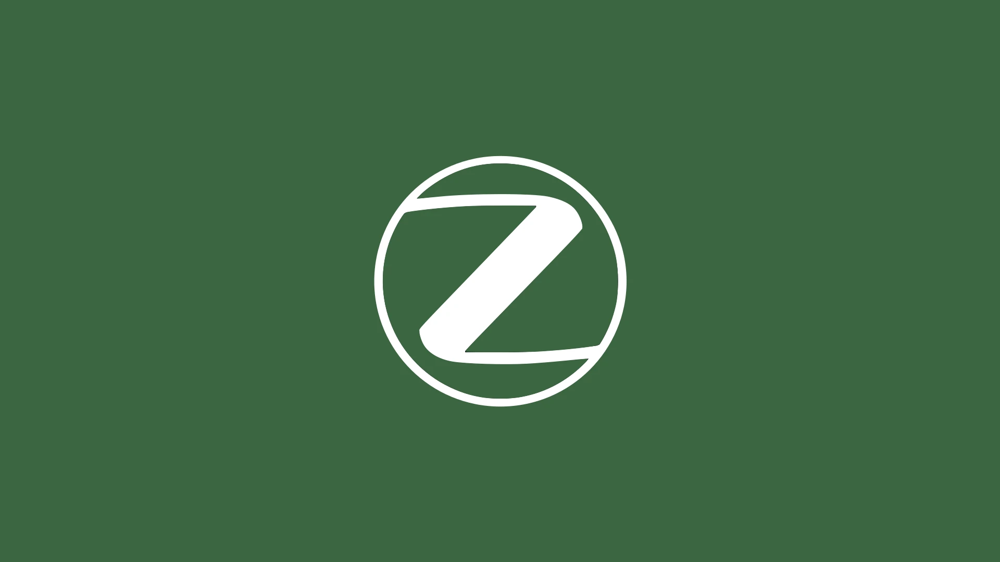
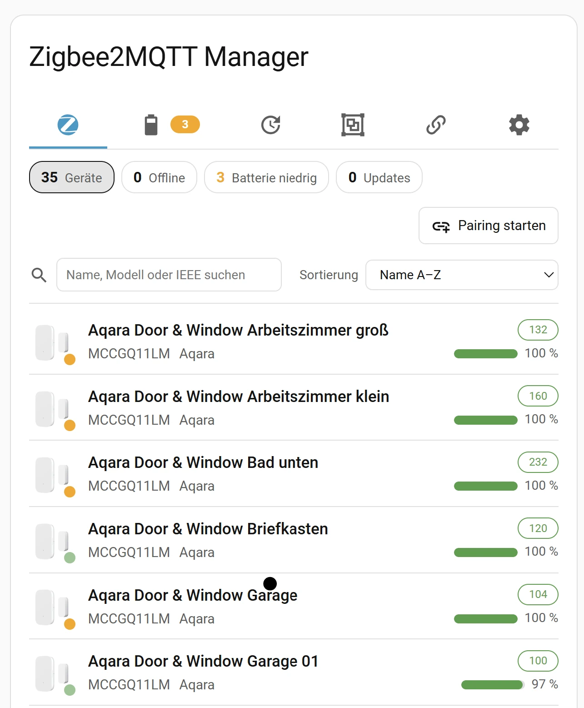

| [🇩🇪<br>**Deutsch**](README.md) | [🇬🇧<br>**English**](README.en.md) | [🇳🇱<br>**Nederlands**](README.nl.md) | [🇫🇷<br>**Français**](README.fr.md) | [🇪🇸<br>**Español**](README.es.md) | [🇮🇹<br>**Italiano**](README.it.md) | [🇷🇸<br>**Српски**](README.sr.md) | 🇷🇴<br>**Română** |
|:-:|:-:|:-:|:-:|:-:|:-:|:-:|:-:|



# Zigbee2MQTT Manager pentru Home Assistant

📖 **Ghid detaliat cu explicații (în germană):** [Zigbee2MQTT Manager pentru Home Assistant pe meinesmartewelt.de](https://meinesmartewelt.de/zigbee2mqtt-manager-home-assistant/)

> **Notă despre traducere:** acest README este o versiune **prescurtată** în limba română. Descrierea completă a tuturor funcțiilor se găsește în [versiunea germană](README.md) și în [versiunea engleză](README.en.md). Corecturile sunt binevenite ca Issue sau Pull Request pe GitHub.

<p>
  <a href="https://my.home-assistant.io/redirect/hacs_repository/?owner=Meine-smarte-Welt&amp;repository=zigbee2mqtt_manager&amp;category=integration"></a>
</p>

Administrează Zigbee2MQTT fără să părăsești Home Assistant: dispozitive, baterii, actualizări de firmware, grupuri, legări (bindings) și bridge-ul, într-un singur card de dashboard – ca integrare HACS.



## Cuprins

- [Funcții](#funcții)
- [Noutăți în 1.4.0](#noutăți-în-140)
- [Cerințe](#cerințe)
- [Instalare](#instalare)
- [Cardul](#cardul)
- [Limitări cunoscute](#limitări-cunoscute)
- [Depanare](#depanare)
- [Istoricul versiunilor](#istoricul-versiunilor)
- [Licență](#licență)

## Funcții

Cardul are șapte categorii într-o bară de pictograme (sub aproximativ 480 px lățime a cardului apar doar pictogramele). Fiecare categorie poate fi afișată sau ascunsă separat.

| Categorie | Ce face |
|---|---|
| **Dispozitive** | Listă cu disponibilitate, model, semnal, baterie, „văzut ultima dată”; statistici ca filtre (offline / baterie slabă / actualizări); căutare; sortare; **grupare** după producător sau tipul dispozitivului; **filtre** (stare, alimentare, semnal, …) |
| **Baterie** | Dispozitivele cu baterie, cele mai slabe primele; culori după pragul „slab” și „critic” |
| **Actualizări** | Firmware instalat vs. disponibil; „verifică tot” și „instalează tot, pe rând”, ca sarcină în fundal cu progres și anulare |
| **Grupuri** | Creare, redenumire, ștergere; adăugare și eliminare de membri |
| **Legări (Bindings)** | Privire de ansamblu asupra tuturor legărilor; desfacere; legare din nou în fereastra dispozitivului |
| **Rețea** | **Harta rețelei** construită din tabelele de vecini ale routerelor: coordonator, routere și „nori” de dispozitive finale; sub hartă, câte un acordeon pentru fiecare router, cu conexiunile sale; buton către interfața Zigbee2MQTT |
| **Bridge** (roată dințată) | **Versiunile aplicației și ale Zigbee2MQTT** (verificare automată a actualizărilor, link colorat către release și notificare persistentă în HA), stare, coordonator, împerechere (pairing), opțiuni bridge, repornire, jurnal de evenimente, **Notification Center** |

**Fereastra dispozitivului** (atingi un rând) conține secțiuni tip acordeon: Informații · **Funcții (expose)** · **Entități (pentru automatizări)** · Redenumire (cu lista entităților HA afectate) · Opțiunile dispozitivului · Firmware · Legări · Grupuri · Eliminare.

Alte funcții:

- **Cache:** bateria, semnalul, starea OTA și „văzut ultima dată” se păstrează după repornirea Home Assistant.
- **Confirmare cu două atingeri** în loc de dialog de browser, pentru acțiuni riscante (eliminare, actualizare, repornire, desfacere legare, ștergere).
- **Doar citire:** `read_only: true` ascunde toate comenzile care modifică ceva (de exemplu pentru tablete montate pe perete).
- **Zoom:** `zoom` scalează întregul card.
- **Limbi:** germană, engleză, olandeză, franceză, spaniolă, italiană, sârbă și **română** (conform limbii Home Assistant).
- **Descărcare diagnostic** cu nume și adrese IEEE anonimizate.

## Noutăți în 1.4.0

- **Funcții experimentale (nou):** funcțiile noi sunt **ascunse implicit**. Comutator principal în **Configurare** (oprit), cheia cardului `show_experimental` (oprită) și un comutator pentru fiecare funcție în **Bridge → Experimental** (oprit). Dacă oricare este oprit, nu se schimbă nimic față de 1.3.1 (vezi `EXPERIMENTELL.md`).
- **Setarea directă a valorilor numerice (issue #26, `expose_numeric_edit`)** și **lista de dispozitive pe mai multe coloane (issue #24, `list_columns`)**, ambele experimentale.
- **Italiană** (PR #25, Salvatore Scalzi) și **sârbă în Notification Center** (PR #28, Brano).
- Complet compatibil cu 1.3.1; nu a fost eliminat nimic.

## Cerințe

- Home Assistant **2025.6** sau mai nou
- **Integrarea MQTT** configurată
- **Zigbee2MQTT 2.x** (versiunea 1.x este detectată și marcată în card ca nesuportată)
- Recomandat: în Zigbee2MQTT setează `availability: true`, altfel nu există starea online/offline. Pentru „văzut ultima dată” setează și `advanced.last_seen: ISO_8601`.

## Instalare

1. HACS → ⋮ → **Custom repositories** → adresa acestui repository, categoria **Integration**
2. Instalează „Zigbee2MQTT Manager” și repornește Home Assistant
3. **Setări → Dispozitive și servicii → Adaugă integrare → Zigbee2MQTT Manager**
4. Introdu *base topic*-ul (implicit `zigbee2mqtt`) și alege pragul pentru „baterie slabă”

Manual: copiază folderul `custom_components/zigbee2mqtt_manager` în `<config>/custom_components/`.

**Linkuri rapide:** [Adaugă repository-ul în HACS](https://my.home-assistant.io/redirect/hacs_repository/?owner=Meine-smarte-Welt&repository=zigbee2mqtt_manager&category=integration) · [Configurează integrarea](https://my.home-assistant.io/redirect/config_flow_start/?domain=zigbee2mqtt_manager). După configurare, integrarea adaugă în bara laterală o intrare **Zigbee2MQTT** (panou Home Assistant, doar pentru administratori) care afișează cardul pe toată pagina – nu e nevoie de dashboard. Poate fi dezactivată în **Configurare → Intrare în bara laterală**. Un șablon de dashboard gata făcut se găsește în `examples/dashboard-zigbee.yaml`.

## Cardul

Integrarea servește cardul și îl înregistrează automat ca resursă Lovelace; nu trebuie să adaugi nimic manual. Dacă Lovelace rulează în mod YAML, adaugă `/zigbee2mqtt_manager_files/zigbee2mqtt-manager-card.js` ca resursă de tip `module`.

Adaugă cardul: **Editează dashboard → Adaugă card → „Zigbee2MQTT Manager”**. Editorul grafic grupează toate setările în secțiuni pliabile; YAML nu este necesar, dar este posibil:

```yaml
type: custom:zigbee2mqtt-manager-card
title: Zigbee2MQTT Manager   # gol ("") = fără titlu
show_devices: true
show_battery: true
show_updates: true
show_groups: true
show_bindings: true
show_bridge: true
default_tab: devices
```

Lista completă a opțiunilor, serviciile, evenimentele pentru automatizări, senzorii și setările culorilor sunt descrise în [versiunea engleză](README.en.md); exemple gata de folosit se găsesc în folderul `examples/`.

## Limitări cunoscute

- **Stare de testare 1.4.0:** backend-ul (50 de cazuri de test într-un mediu de test Home Assistant real) și cardul în Chrome (headless), cu date generate de backend. **Neverificat:** hardware real, o instalare Home Assistant în funcțiune, Firefox, Safari, aplicația companion. Textele în română, italiană și sârbă **nu au fost verificate de vorbitori nativi** de către autor.
- Majoritatea funcțiilor au fost testate cu date simulate, **nu pe hardware real** (detalii în [versiunea engleză](README.en.md#known-limitations)).
- Opțiunile dispozitivului acceptă doar tipuri simple (număr, comutator, alegere, text), fără opțiuni imbricate.
- Clipboard-ul (copierea) funcționează doar prin HTTPS.

## Depanare

- **Cardul nu este găsit:** golește cache-ul browserului; în Setări → Dashboard-uri → Resurse verifică dacă există `/zigbee2mqtt_manager_files/…` (în modul YAML adaug-o manual).
- **Dispozitiv afișat offline, deși este accesibil:** starea este raportată chiar de Zigbee2MQTT (`<base_topic>/<dispozitiv>/availability`). Verifică valoarea acolo (de exemplu cu MQTT Explorer). Pentru dispozitivele cu baterie, Z2M marchează „offline” abia după ore fără mesaje.
- **Fără stare online/offline:** activează `availability: true` în Zigbee2MQTT.
- **„Văzut ultima dată” lipsește:** setează `advanced.last_seen: ISO_8601`.
- **„Fără conexiune la integrare”:** este integrarea încărcată? Se potrivesc `base_topic` sau `entry_id`?
- **Banner „versiune nesuportată”:** Zigbee2MQTT 1.x nu este suportat.
- Jurnale: setează `custom_components.zigbee2mqtt_manager` pe `debug`.

## Istoricul versiunilor

| Versiune | Modificări |
|---|---|
| **1.4.0** | Nou (experimental, oprit implicit): **valori numerice** ale funcțiilor scriibile în fereastra dispozitivului (#26) și **listă de dispozitive pe mai multe coloane** (#24), controlate de un comutator principal, cheia `show_experimental` și un comutator pe funcție. Nou: limba **italiană** (PR #25), **sârbă** în Notification Center (PR #28). |
| **1.3.1** | Corectat: **lista de dispozitive sărea înapoi sus în timpul derulării**. |
| **1.3.0** | Nou: **harta rețelei** cu zoom și tragere cu mouse-ul, **descrierea** dispozitivului din Zigbee2MQTT în listă și în fereastră, **dispozitive pierdute**, **ignorarea stării offline**, **broker MQTT extern** (experimental), **verificarea actualizărilor Zigbee2MQTT**, **pictograma integrării lângă titlu**, **editor de card în mai multe limbi** (issue #22) și limba **română** (PR #21, mulțumiri @robex2005). |
| 1.2.2 și mai vechi | Vezi [istoricul versiunilor din versiunea engleză](README.en.md#version-history). |

## Licență

MIT – vezi [LICENSE](LICENSE).
